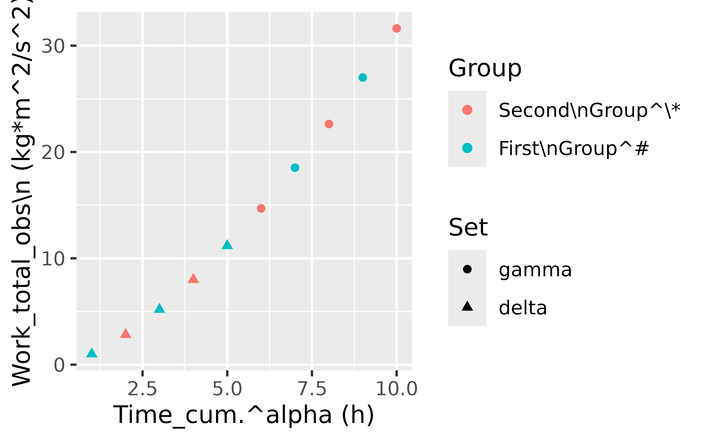
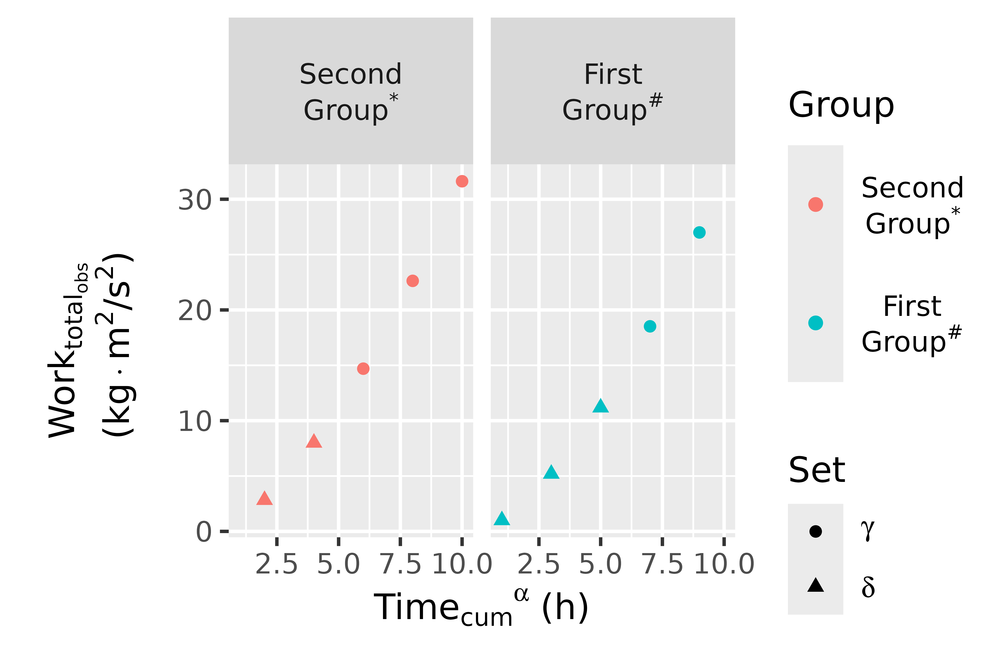

# Scripted HTML

The point of this exercise is to demonstrate flexible rendering of
subscripts and superscripts. We want to write expressions for column
labels and units that are fairly readable as they are, and yet can be
easily rendered with equivalent results in plotmath, html, or pdf.

First we load some packages.

``` r

library(magrittr)
library(ggplot2)
library(tablet)
library(yamlet)
library(dplyr)
library(kableExtra)
```

We create some example data.

``` r

x <- data.frame(
  time = 1:10, 
  work = (1:10)^1.5, 
  group = 1:2, 
  set = c(rep('delta',5), rep('gamma', 5))
)
x %<>% decorate('
 time: [ Time_cum.^alpha, h ]
 work: [ Work_total_obs\\n, kg*m^2/s^2 ]
 group: [ Group, [ Second\\nGroup^\\*: 2, First\\nGroup^#: 1 ]]
 set: [ Set, [ gamma, delta ]]
')
x %>% decorations
```

    ## - time
    ##  - label: Time_cum.^alpha
    ##  - guide: h
    ## - work
    ##  - label: Work_total_obs\n
    ##  - guide: kg*m^2/s^2
    ## - group
    ##  - label: Group
    ##  - guide
    ##   - Second\nGroup^\*: 2
    ##   - First\nGroup^#: 1
    ## - set
    ##  - label: Set
    ##  - guide: gamma, delta

The label for column `work` has nested subscripts suggesting
\$\sf{Work\_{total\_{obs}}}\$. The label for column `time` suggests
\$\sf{Time\_{cum}{}^{\alpha}}\$. The dot closes the subscript to
distinguish this from \$\sf{Time\_{cum^{\alpha}}}\$. Backslash-n
requests a line break.

How does this look when we plot it?

``` r

x %>% 
  resolve %>% 
  ggplot(aes(time, work, color = group, shape = set)) + 
  geom_point()
```



By default, we get verbatim labels and units as substitutes for column
names.

Next, we use
[`enscript()`](https://bergsmat.github.io/yamlet/reference/enscript.md)
instead of
[`resolve()`](https://bergsmat.github.io/yamlet/reference/resolve.md) to
indicate that the labels should be understood as potentially having
subscripts and superscripts. For this to work well, units should be
constructed using \*, /, and ^ (even though the “units” package supports
other encodings).

``` r

x %>% 
  enscript %>% 
  ggplot(aes(time, work, color = group, shape = set)) + 
  facet_grid(~ group) +
  geom_point()
```



In the background,
[`enscript()`](https://bergsmat.github.io/yamlet/reference/enscript.md)
is writing **expression** and **plotmath** attributes (consumed by
[`ggplot()`](https://ggplot2.tidyverse.org/reference/ggplot.html) ) and
**title** attributes (consumed by
[`tablet()`](https://rdrr.io/pkg/tablet/man/tablet.html) ). We
illustrate the latter.

``` r

x %>% 
  enscript %>% 
  group_by(group, set) %>%
  tablet %>%
  as_kable
```

[TABLE]

In summary, we have decorated our data with labels and units containing
markup for subscripts and superscripts. If everything goes well, these
render similarly in figures and tables. They also render similarly in
html and pdf. Please see the pdf version of this document.
